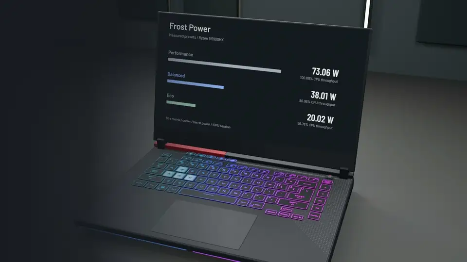
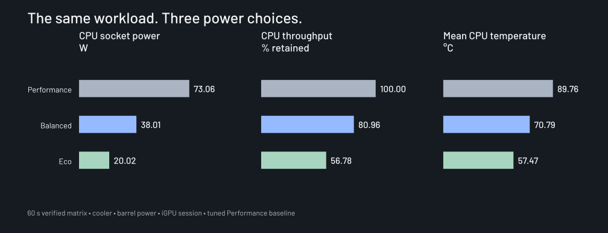
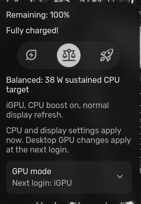

<p align="center">
  <a href="media/frost-power.mp4"></a>
</p>
<p align="center"><a href="media/frost-power.mp4">Watch the 20-second film with sound</a> · <a href="docs/results.md">Measurements</a> · <a href="docs/recovery.md">Recovery</a></p>

# Frost Power

Less heat. Same laptop.

Power presets and undervolt notes from an **ASUS ROG G513QY**, with a Ryzen 9 5900HX, Vega iGPU and RX 6800M. This repo holds the controller, Battery-menu integration, test fixtures and the measurements used to choose the settings.

[](https://github.com/ilyasmohaimel/frost-power/actions/workflows/check.yml)

## Three presets, measured on the same machine



| Preset | Measured CPU socket power | CPU throughput retained | Mean CPU temperature |
| --- | ---: | ---: | ---: |
| Performance | 73.06 W | 100% | 89.76°C |
| Balanced | 38.01 W | 80.96% | 70.79°C |
| Eco / Quiet | 20.02 W | 56.78% | 57.47°C |

These are **60-second verified matrix tests**, on barrel power, with a laptop cooler and an iGPU desktop. The baseline already includes the small CPU curve adjustment and 90°C target. Power is the processor's SMU socket reading, not a wall-meter or battery reading. Short bursts and other workloads behave differently.

Balanced kept almost all single-thread throughput and lost about 10% in the multi-thread prime test. Eco lost about 30% and 33% respectively. [The candidate sweep and repeat tests](docs/results.md) explain why 38 W and 20 W were selected.

## Pick it in Battery

The original sliding capsule selects Eco (leaf), Balanced (scales) and Performance (rocket). The GPU choices stay in the collapsed submenu below.



| Choice | Sustained APU limit | CPU boost | Internal display | Next Hyprland login |
| --- | ---: | --- | --- | --- |
| Performance | ASUS native limit | On, unless disabled elsewhere | Restore previous refresh | RX on barrel; iGPU on USB-C/battery |
| Balanced | 38 W | On, unless disabled elsewhere | Restore previous refresh | iGPU |
| Eco / Quiet | 20 W | Off | 60 Hz, when supported | iGPU |

CPU and display settings apply in the current session. **Hyprland's desktop GPU changes at the next login.** Open apps do not migrate between GPUs here. The tested display normally runs at 300 Hz, so Eco also trades display smoothness for lower refresh.

Balanced saves Balanced for AC and battery. Eco saves Quiet for both. Performance saves Performance for AC and Quiet for battery. The USB-C policy respects an explicitly selected Balanced preset; otherwise it chooses Quiet. The GPU submenu remains available for manual next-login choices.

## A small undervolt, with limits

- CPU: Curve Optimizer request **−5**, with a **90°C** target. Firmware acknowledgement is available; a direct curve-voltage readback is not.
- RX 6800M: **−30 mV**, with automatic clocks. Routine monitoring touches it only when the existing GPU policy deliberately holds it awake.
- iGPU: voltage remains stock. No speculative graphics-curve value was applied.

The earlier stock-versus-tuned CPU comparison lost 2.58% throughput while reducing measured CPU socket power by 15.65%. That was a separate October 25 experiment. The RX test still reached 101°C junction; its different run lengths and cooling curves make its power saving directional evidence. [Full findings and rejected settings](docs/results.md).

## The RX should be allowed to sleep

Two practical fixes matter here:

1. Hyprland sometimes printed diagnostic lines around its instance JSON. Failed session registration made the controller fall back to the barrel-power RX policy. The parser now handles that output, and startup retries registration.
2. Deeply sleeping RX hardware rejects voltage-control reads. Explicit rollback now briefly wakes it, clears the owned offset and restores its previous runtime policy. The normal monitoring loop does not do this.

CPU tests kept the RX suspended throughout. Vulkan device enumeration briefly woke it for about seven seconds at application startup, then it returned to `suspended` / `D3cold`. That startup event is distinct from repeated desktop-renderer switches.

[How the controllers cooperate](docs/how-it-works.md)

## Read and test before applying

```sh
git clone https://github.com/ilyasmohaimel/frost-power.git
cd frost-power
python3 tools/inspect_system.py
python3 -m unittest discover -s tests -p 'test_*.py' -v
python3 tools/check_evidence.py
```

The inspection command reads identity, profile and cached power state. It does not read dGPU voltage controls or change settings. The 64 unit tests use fixtures; they do not stress or tune your laptop.

This is a **machine-specific reference**, not an automatic installer. The [G513QY integration map](reference/g513qy/README.md) lists the exact destinations, dependencies and recovery prerequisites. [Porting notes](docs/porting.md) cover other AMD systems and the Intel/NVIDIA boundary. Do not copy these voltage values to different hardware.

## Keep a way back

An independent GRUB recovery root was boot-tested before tuning, with its own preserved kernel and initramfs. Root and home baselines are separate. The current controller also supports an owned-settings reset and re-enable path.

The revised controller passed CPU and iGPU tests, automatic service recovery, full reset and re-enable. **The new presets have not yet been verified through a reboot, hibernation or an unplugged runtime test.** Earlier tuning passed reboot and hibernation, which does not prove this revision.

[Recovery design, reset procedure and verification boundaries](docs/recovery.md)

## Related work

| Repository | Role |
| --- | --- |
| [dotfiles-linux](https://github.com/ilyasmohaimel/dotfiles-linux) | The Hyprland/Caelestia desktop, themes and everyday configuration |
| [frost-gpu](https://github.com/ilyasmohaimel/frost-gpu) | Experimental KDE compositor/app migration, GPU policy and charger detection |
| [linux-setup-recovery](https://github.com/ilyasmohaimel/linux-setup-recovery) | Private restore notes and selected application recovery; access required |
| [used-laptop-testing-iso](https://github.com/ilyasmohaimel/used-laptop-testing-iso) | A separate hardware inspection and used-laptop testing workflow |

Frost GPU's live KDE migration is separate from this repo's next-login Hyprland selection. Installing a power preset does not add live migration to Hyprland.

## Inside

```text
src/                    Installed thermal controller and owned-setting helpers
config/                 G513QY settings and system service
integration/hyprland/   Preset selection, login registration and USB-C policy
integration/caelestia/  Battery controls and GPU submenu
reference/g513qy/       Existing GPU policy dependencies and integration map
data/                   Selected numeric evidence, without private session state
tests/                  64 portable policy and rollback checks
docs/                   Results, recovery, architecture and porting notes
media/                  Film, editable composition, model recipe and credits
```

The original controller code is GPL-2.0-only. Caelestia-derived QML keeps its upstream GPL-3.0 license. Fonts, music, model materials and dependencies retain their own terms. [Credits and license map](THIRD_PARTY.md).
