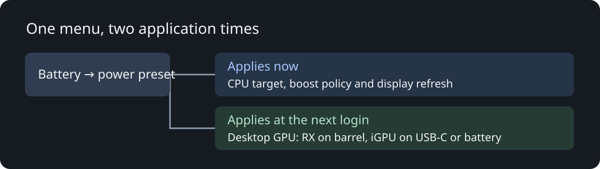

# How the pieces cooperate

There are three separate decisions: processor limits, desktop GPU selection and the dedicated GPU's runtime policy.

## Processor limits

`frost-thermal-tuning` reads ASUS's active platform profile. ASUS remains the profile authority. The controller requests the tested CPU curve and temperature target, then applies the sustained APU limit through RyzenAdj. Eco also disables CPU boost.

`ProfilePower` records the limits and boost state it owns. Reapplying a setting preserves the original value. Leaving Eco releases its owned boost setting. A lower setting chosen elsewhere is preserved rather than raised to the preset ceiling. Ownership is saved before the firmware settling delay and retained through an automatic service restart.

There is a delay after profile changes because firmware can overwrite the settings asynchronously. The loop checks for drift and reapplies the selected policy. The UI reports that settings are still applying instead of treating the ASUS profile name as proof of completed tuning.

## Hyprland selection

The session launcher chooses the compositor GPU at login and removes the KDE migration environment. Automatic uses RX on barrel power and iGPU on USB-C/battery. Explicit iGPU, RX and Eco choices are available.

The registration record identifies the current compositor process, session and GPU. The root power controller verifies that record against the actual process and login session. A saved next-login preference is never treated as proof that the running compositor moved.

Hyprland's instance-list output can contain diagnostics around its JSON. The parser scans for a valid instance list; activation retries after startup. Systemd-launched clients can verify the registered compositor when they did not inherit the private login variables.

This does not implement live app or compositor migration. [Frost GPU](https://github.com/ilyasmohaimel/frost-gpu) holds that separate experimental KDE work.

## RX voltage and sleep

The RX helper reads cached `power/control` and runtime state first. With policy `auto`, normal monitoring does not read GPU sensors or voltage controls. It does not force the RX awake to apply an offset.

When the established GPU policy holds the RX awake, the helper waits for stable active state and a junction temperature below 65°C before applying the tested offset. A different voltage setting or manual clock owner is preserved.

Explicit rollback is different: the voltage interface rejects D3cold reads. Reset temporarily requests `on`, waits for active state, clears the matching owned offset, then restores the previous runtime policy in a `finally` block. A failed wake or voltage read still releases that temporary request.

## Display policy

Eco uses the internal panel's reported 60 Hz mode. Before changing it, the helper records geometry, scale, transform, refresh and the Hyprland instance signature. Leaving Eco restores that recorded mode only if the current mode still matches the setting it owns. An independent display change is preserved.

A failed readback after a display change attempts to restore the previous mode. If that rollback also fails, ownership is retained for a later recovery attempt. Display state lives in the user's runtime directory and does not survive into a different compositor instance.

## Existing boundaries

The reference assumes the tested AMD pair, user 1000 in the root GPU-policy integration, an eDP-1 internal panel and the established Frost GPU power classifier. Those details need deliberate porting. Neither a profile label nor an active service proves physical RX power-off; read the cached runtime and PCI power states.
